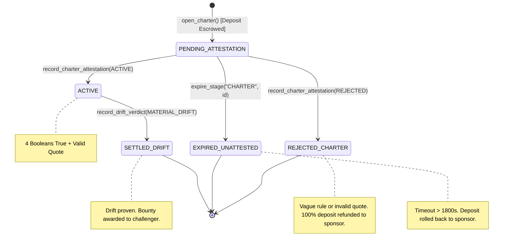

# LexDrift Technical Architecture Specification

> **System**: LexDrift Multi-Snapshot Legal & Governance Policy Drift Sentinel  
> **Platform**: GenLayer Intelligent Contracts Framework (`py-genlayer`)  
> **Target Network**: GenLayer StudioNet (Chain ID: `61999`)  
> **Runner Hash**: `py-genlayer:1jb45aa8ynh2a9c9xn3b7qqh8sm5q93hwfp7jqmwsfhh8jpz09h6`

---

## 1. System Overview & Component Topology

LexDrift is engineered as a decoupled, multi-contract decentralized sentinel. It eliminates single-point-of-failure vulnerabilities and nondeterministic state corruption by enforcing a strict physical partition between **deterministic financial custody** and **non-deterministic AI validator consensus**.

```
                                  ┌───────────────────────────┐
                                  │      DAO Treasury /       │
                                  │      Policy Sponsor       │
                                  └─────────────┬─────────────┘
                                                │ 1. open_charter()
                                                │    [payable]
                                                ▼
┌─────────────────────────────┐   ┌───────────────────────────┐   ┌─────────────────────────────┐
│       Auditor Sentinel      │   │         LEXVAULT          │   │      Challenger Actor       │
│      (Dispute Watchdog)     ├──►│ (Deterministic State Core)│◄──┤     (MEV / Bug Bounty)      │
│                             │   │                           │   │                             │
│ • Monitors Repositories     │   │ • Total Escrow & TVL      │   │ • Submits Commit-Reveal Hash│
│ • Detects License Drift     │   │ • Mathematical Invariants │   │ • Stakes Challenger Bond    │
│ • Initiates Claim Seal      │   │ • Pull Payment Escrow     │   │ • Triggers Reconcile        │
└─────────────────────────────┘   └──────┬─────────────┬──────┘   └─────────────────────────────┘
                                         │             │
                    2. emit              │             │ 6. emit
                       attest_charter()  │             │    audit_drift()
                                         ▼             ▼
                          ┌────────────────────┐ ┌────────────────────┐
                          │    CHARTERGATE     │ │    DRIFTAUDITOR    │
                          │ (4-Boolean RuleGate│ │(6-Boolean Engine & │
                          │ & Baseline Witness)│ │ Snapshot Auditor)  │
                          └─────────┬──────────┘ └─────────┬──────────┘
                                    │                      │
                                    │ 3. nondet web.get()  │ 7. nondet web.get()
                                    │    (T0 Baseline)     │    (T0 & T1 Snapshots)
                                    ▼                      ▼
                          ┌───────────────────────────────────────────┐
                          │         Cryptographic Web Sources         │
                          │   • GitHub Raw (Pinned Commit SHA-40)     │
                          │   • Wikipedia API (Action parse, oldid)   │
                          │   • Wayback Machine (id_ Snapshot URI)    │
                          └───────────────────────────────────────────┘
```

---

## 2. Core Contracts & Functional Responsibilities

### 2.1. `LexVault` (`contracts/lex_vault.py`)
- **Role**: Purely deterministic financial controller and state repository.
- **Contract Address**: `0x270BBA964dB0C88363de6986Ef8D88090864456b`
- **Execution Model**: Deterministic only. Never executes `gl.nondet` web requests or LLM prompts.
- **Key Storage Maps**:
  - `charters: TreeMap[u256, str]`: Serialized JSON metadata of all governance charters.
  - `claims: TreeMap[u256, str]`: Serialized JSON metadata of all comparative drift claims.
  - `commitments: TreeMap[str, u256]`: Mapping from `SHA-256(url:salt)` to claim ID.
  - `pull_credits: TreeMap[str, u256]`: Beneficiary pull-payment balances available for withdrawal.
  - `pending_outbound: TreeMap[u256, str]`: Outbound transfers undergoing two-step reconciliation.
- **Accounting State**:
  - `total_escrow: u256`: Total GEN tokens locked in active charter bounties and pending claim bonds.
  - `total_credits: u256`: Total GEN tokens available for pull-claim withdrawals.
  - `total_pending_outbound: u256`: Total GEN tokens in transit via cross-chain `emit_transfer`.
  - `total_value_locked: u256`: Total native GEN balance deposited into the contract.

### 2.2. `CharterGate` (`contracts/charter_gate.py`)
- **Role**: Non-deterministic RuleGate and baseline ground-truth witness.
- **Contract Address**: `0xa7ae55747b61d4Eb9d7024F0C19bd6499262c51c`
- **Execution Model**: Non-deterministic leader execution with multi-validator consensus (`gl.vm.run_nondet_unsafe`).
- **Invariants Enforced**:
  - URL must match immutable allowlist (`GitHub Raw SHA-40`, `Wikipedia oldid`, `Wayback id_`).
  - Fetched baseline document bounded to 8,000 characters and hashed via `SHA-256`.
  - LLM evaluates 4 strict booleans: `observable_criterion`, `specific_scope`, `falsifiable_condition`, `baseline_entails_guarantee`.
  - Verbatim baseline quote must be an exact substring of the fetched baseline slice ($8 \le \text{len} \le 300$).

### 2.3. `DriftAuditor` (`contracts/drift_auditor.py`)
- **Role**: Non-deterministic comparative multi-snapshot policy drift auditor.
- **Contract Address**: `0xB6C7bC7cbd182c90cbc814Ec3d80CCEc604E600d`
- **Execution Model**: Non-deterministic leader execution with multi-validator consensus.
- **Invariants Enforced**:
  - URL allowlist check on both $T_0$ and $T_1$.
  - Byte short-circuit: if $\text{SHA256}(T_0) == \text{SHA256}(T_1)$, instantly returns `BENIGN_REVISION`.
  - LLM evaluates 6 strict booleans: `same_subject`, `chronology_valid`, `baseline_granted_right`, `candidate_modifies_clause`, `materially_adverse_shift`, `not_carved_out`.
  - Derives deterministic `closure_basis` digest: `{VERDICT}:{T0_hash16}:{T1_hash16}:{q0_hash12}:{q1_hash12}`.

---

## 3. Two-Phase Immutable Bootstrap Protocol

To resolve circular address dependencies during deployment without opening administrative backdoors, LexDrift uses a two-phase bootstrap pattern:

1. **Phase 1: Instantiation**
   - Deploy `LexVault()`. The deployer's address is stored as `bootstrapper`.
   - Deploy `CharterGate(vault_address)`.
   - Deploy `DriftAuditor(vault_address)`.
2. **Phase 2: Configuration & Irreversible Key Destruction**
   - The deployer calls `LexVault.configure(charter_gate_addr, drift_auditor_addr)`.
   - `LexVault` verifies caller identity, records worker addresses, and executes:
     ```python
     self.bootstrapper = ""  # Permanently wiped
     ```
   - From this point forward, no address can ever reconfigure or re-bind workers. The system is fully immutable.

---

## 4. State Machines & Lifecycle Transitions

### 4.1. Charter State Machine



### 4.2. Claim State Machine (Commit-Reveal FIFO Queue)

```mermaid
stateDiagram-v2
    [*] --> SEALED: seal_claim() [Bond Escrowed]
    note right of SEALED: Commitment = SHA256(url:salt)
    
    SEALED --> AUDITING: disclose_claim() [Reveal url + salt]
    note right of AUDITING: Hash matches commitment. Triggers DriftAuditor.
    
    AUDITING --> SETTLED_MATERIAL_DRIFT: record_drift_verdict(MATERIAL_DRIFT)
    note right of SETTLED_MATERIAL_DRIFT: Bounty + Bond credited to challenger pull balance.
    
    AUDITING --> REJECTED_BENIGN_REVISION: record_drift_verdict(BENIGN_REVISION)
    note right of REJECTED_BENIGN_REVISION: Bond forfeited into charter bounty pool.
    
    AUDITING --> REJECTED_EVIDENCE: record_drift_verdict(REJECTED_EVIDENCE)
    note right of REJECTED_EVIDENCE: Prompt injection or unrelated URL. Bond forfeited to sponsor.
    
    AUDITING --> EXPIRED_CLAIM: expire_stage("CLAIM", id)
    note right of EXPIRED_CLAIM: Timeout > 1800s. Bond refunded to challenger.
```

---

## 5. Mathematical Conservation Invariant & Solvency Proof

LexDrift implements a mathematically closed economic system. No token can enter or exit the vault without adjusting the three constituent accounting pools.

### The Formal Invariant Equation

$$\forall \text{ state transitions } S_i \to S_{i+1}:$$

$$\text{total\_escrow}(S) + \text{total\_credits}(S) + \text{total\_pending\_outbound}(S) = \text{total\_value\_locked}(S)$$

### Inductive Solvency Proof Across All Operations

1. **Deposit Operations (`open_charter`, `seal_claim`, `recapitalize_payouts`)**:
   - $\Delta \text{TVL} = +V$
   - Either $\Delta \text{total\_escrow} = +V$ (valid submission) or $\Delta \text{total\_credits} = +V$ (validation reject / refund).
   - Invariant: $(E + V) + C + P = \text{TVL} + V \implies \text{Preserved}$.
2. **Charter Rejection / Timeout (`record_charter_attestation`, `expire_stage`)**:
   - $\Delta \text{total\_escrow} = -B$
   - $\Delta \text{total\_credits} = +B$
   - Invariant: $(E - B) + (C + B) + P = \text{TVL} \implies \text{Preserved}$.
3. **Material Drift Settlement**:
   - Total payout $T = \text{Bounty} + \text{Bond}$.
   - $\Delta \text{total\_escrow} = -T$
   - $\Delta \text{total\_credits} = +T$
   - Invariant: $(E - T) + (C + T) + P = \text{TVL} \implies \text{Preserved}$.
4. **Benign Revision Rejection**:
   - Bond $K$ transferred from claim escrow to charter bounty escrow.
   - $\Delta \text{total\_escrow} = 0$, $\Delta \text{total\_credits} = 0$, $\Delta \text{TVL} = 0$.
   - Invariant: Preserved.
5. **Withdrawal Request (`request_withdrawal`)**:
   - $\Delta \text{total\_credits} = -W$
   - $\Delta \text{total\_pending\_outbound} = +W$
   - Invariant: $E + (C - W) + (P + W) = \text{TVL} \implies \text{Preserved}$.
6. **Withdrawal Reconciliation (`reconcile_withdrawal`)**:
   - $\Delta \text{total\_pending\_outbound} = -W$
   - $\Delta \text{TVL} = -W$
   - Invariant: $E + C + (P - W) = \text{TVL} - W \implies \text{Preserved}$.

The contract executes `_assert_invariant()` at the conclusion of every single state-modifying function. If any computation breaches this equality by even 1 wei, the entire transaction reverts.
